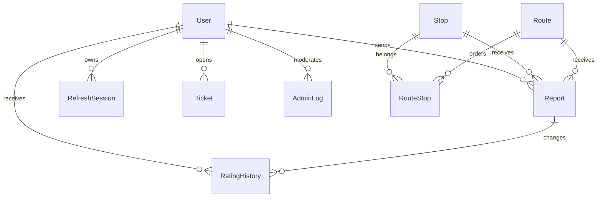
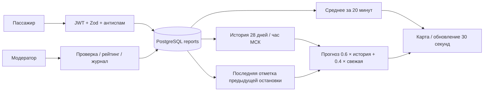
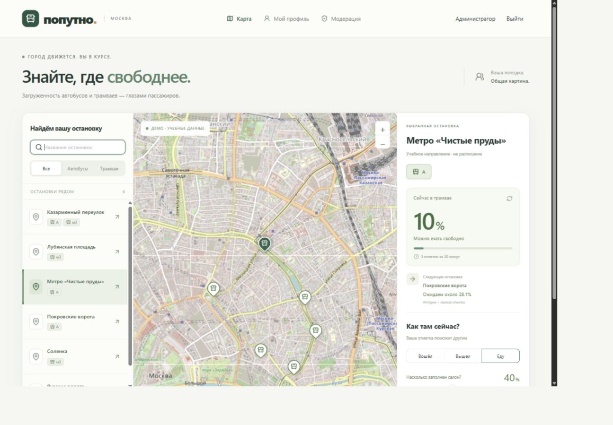
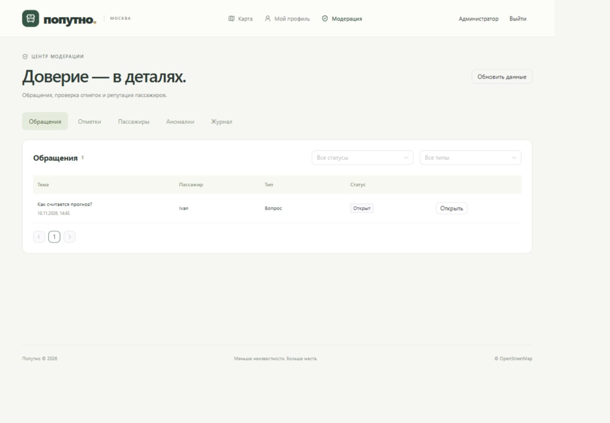

# Попутно · Наземный транспорт Москвы: Загруженность

[](https://github.com/M1qght/moscow-transit-load/actions/workflows/ci.yml)


Я сделал карту, на которой пассажиры делятся загруженностью автобусов и трамваев. Выбираю остановку, маршрут и отмечаю заполненность салона. Другие видят среднее за последние 20 минут и оценку для следующей остановки. Название репозитория — `moscow-transit-load`, короткое имя интерфейса — «Попутно».

Это работающий локальный full-stack проект с PostgreSQL, авторизацией, модерацией и тестами. Это **не официальный сервис транспорта Москвы**, не трекинг конкретных машин и не измерение датчиками. Две машины одного маршрута могут иметь разную загрузку; сейчас они агрегируются вместе. Демо-сид содержит синтетические отметки и учебные направления, интерфейс показывает это явно.

## Что можно сделать

- Смотреть карту без регистрации, искать остановки, фильтровать автобусы и трамваи, переключать направления.
- Зарегистрироваться и отправить «вошёл / вышел / еду» с загрузкой 0–100%.
- Увидеть арифметическое среднее свежих отметок, число наблюдений и прогноз следующей остановки.
- Смотреть собственные отметки, изменения рейтинга, отправлять вопросы/жалобы и читать ответы.
- В `/admin` фильтровать тикеты, отвечать, проверять отметки, менять рейтинг с обязательной причиной, смотреть аномалии и журнал.
- Импортировать настоящие остановки и направления. Подробности — в [data/README.md](data/README.md).

## Стек и решения

| Выбор                                                      | Почему я его взял                                                                                                                                                              |
| ---------------------------------------------------------- | ------------------------------------------------------------------------------------------------------------------------------------------------------------------------------ |
| Vue 3, Composition API, `<script setup>`, Vite, TypeScript | Небольшие компоненты, быстрый dev-сервер, проверка шаблонов через vue-tsc                                                                                                      |
| Pinia, Vue Router                                          | Состояние авторизации и тикетов; маршруты с проверкой роли                                                                                                                     |
| Naive UI                                                   | Vue 3 и TypeScript, аккуратные формы, таблицы данных оставил обычным HTML для контроля адаптивности. Тема настраивается через NConfigProvider                                  |
| Leaflet 1.9.4 + Vue Leaflet                                | Открытая карта без Mapbox-токена. Обёртка поддерживает Vue 3; зафиксировал совместимую стабильную ветку Leaflet 1.x                                                            |
| NestJS 11 + Zod                                            | Guards, DI и тестовый модуль из коробки. Zod валидирует тела и query на границе API; это компактнее отдельных DTO для каждого фильтра                                          |
| PostgreSQL 17 + Prisma 6.19                                | Связи, индексы и транзакции важнее свободной схемы. SQL оставил для исторического часа и оконных функций аномалий; значения параметризованы                                    |
| Argon2id, JWT access + refresh                             | Пароли хешируются, короткий access хранится в памяти, refresh — в HttpOnly-cookie и вращается при использовании                                                                |
| БЭМ, обычный CSS                                           | Собственные блоки называю `block__element_modifier`. Внутренние классы Naive UI остаются библиотечными, точечные стили ограничены моей обёрткой. Tailwind здесь не понадобился |

Не строил микросервисы ради пары таблиц. Здесь один API-процесс и одна БД; горизонтально масштабировать API можно, потому что сессии и блокировка антиспама живут в PostgreSQL. Карта ограничивает выдачу остановок до 1000, списки API пагинированы. Для всего города понадобится запрос по viewport — это в roadmap, а не обещание уже выдерживать миллионы пользователей.

Официальные справочники: [Vue + TypeScript](https://vuejs.org/guide/typescript/overview), [Naive UI](https://www.naiveui.com/), [Vue Leaflet](https://github.com/vue-leaflet/vue-leaflet), [Leaflet 1.x](https://leafletjs.com/reference-1.9.4.html), [NestJS](https://docs.nestjs.com/), [Prisma](https://www.prisma.io/docs/orm/prisma-migrate/workflows/development-and-production).

## Структура

```text
apps/
  api/src/       auth.ts, transport.ts, reports.ts, admin.ts, prediction.service.ts
  api/test/      unit + REST e2e с настоящим PostgreSQL
  web/src/
    components/  LoadReportForm.vue, ReportSlider.vue
    composables/ useTransportMap.ts
    router/      index.ts
    stores/      auth.ts, admin-tickets.store.ts
    views/       MapView.vue, AuthView.vue, ProfileView.vue, AdminView.vue
prisma/          schema.prisma, migrations/, seed.ts
scripts/         importTransport.ts
data/            инструкция импорта
docs/screenshots/
.github/workflows/ci.yml
```

## Схема данных

Полная исполняемая схема — [prisma/schema.prisma](prisma/schema.prisma). Миграция содержит ограничения диапазона загрузки и координат.



`RouteStop(routeId, stopId, order)` задаёт одно направление. Обратное направление — другой Route, даже при том же номере. `Report` содержит действие пассажира, процент, время, статус проверки, признак демо. Роль определяется только полем `users.role`: приложение не проверяет специальный логин. `ratings_history` хранит изменения, `admin_logs` — администратора, объект и детали действия. `refresh_sessions` хранит SHA-256 токена и срок действия.

Индексы покрывают остановку/маршрут/время, пользователя/остановку/время, статусы тикетов. Антиспам блокирует строку пользователя в транзакции и проверяет любую его отметку на этой остановке за N минут, в том числе на другом маршруте.

## Как считаю загрузку



`aggregateCurrentLoad(stopId, routeId)` берёт **все неотклонённые** отметки в `[now − 20 мин, now]`. 5%, 10%, 15% дают 10%. Рейтинг не меняет вес: в задаче требуется обычное среднее. Нет отметок — `load: null`, а не 0.

`calculatePrediction(stopId, routeId, time)` ищет среднее на целевой остановке за последние 28 дней в том же московском часе. Последние 20 минут исключает из истории. Затем находит последнюю неотклонённую отметку предыдущей остановки за 20 минут:

```ts
prediction = 0.6 * historical + 0.4 * previous;
// historical = 40, previous = 10 → 28%
```

Если есть только один источник, использую его и возвращаю соответствующий `confidence` (`history` или `previous`). Если нет обоих — `null / no-data`. С двумя источниками — `combined`. Процент ограничен 0–100 и округлён до десятых. История косвенно учитывает обычный приток пассажиров, отдельной модели посадок пока нет. У конечной остановки следующего прогноза нет. Время работы API — UTC, группировка часа — Europe/Moscow.

Подтверждение даёт +2, отклонение −3. При смене решения учитываю предыдущий вклад: +2 → −3 означает изменение на −5. Повторная модерация с тем же статусом ничего не начисляет. Изменение статуса, рейтинг, история и журнал сохраняются одной транзакцией. От 20 баллов пассажир считается доверенным. Скачки от 50 п.п. за сутки и 5+ отметок за 10 минут — сигналы админу, не автоматический бан.

## Установка и запуск

Нужны Node **22.12+** (или Node 24), npm и Docker Desktop с запущенным Linux engine. На Node 18 проект не рассчитан: современные Vite/NestJS требуют более новую версию. Проверки этого checkout описаны в [docs/verification.md](docs/verification.md).

```sh
cp .env.example .env
docker compose up -d db
npm install
npm run db:migrate
npm run db:seed
npm run dev
```

В PowerShell вместо `cp` можно написать `Copy-Item .env.example .env`.
Перед миграцией дождитесь `healthy` в `docker compose ps`. Открывайте [localhost:5173](http://localhost:5173); API — [localhost:3000/api/health](http://localhost:3000/api/health). Vite проксирует `/api` на NestJS. Если 5432 занят, поменяйте порт и `DATABASE_URL`.

| Аккаунт после demo seed | Пароль из `.env.example` |
| ----------------------- | ------------------------ |
| `admin123`              | `admin123`               |
| `ivan`, `anna`          | `ivan_demo_2026`         |

Администратор создаётся только seed-скриптом из переменных окружения, пароль хранится как Argon2id. После входа роль ADMIN отправляет на `/admin`, у неё появляется навигация модерации. Seed идемпотентен: **не меняет пароли существующих пользователей**, не очищает БД и не сдвигает время старых демо-отметок. Поэтому через 20 минут демо-загрузка исчезнет; отправьте свою отметку. Для базы без учебных записей выставьте `SEED_DEMO=false` до первого запуска seed.

Для своего сервера замените оба JWT-секрета разными случайными строками от 32 символов, пароль PostgreSQL, пароль админа **до первого seed** и уберите демо. Через HTTPS задайте `COOKIE_SECURE=true`, точный `WEB_ORIGIN` и один внешний origin для UI/API за reverse proxy. `npm run build` собирает оба приложения; API запускается `npm run start -w @transit/api`, `apps/web/dist` обслуживается статикой с fallback на index.html и прокси `/api`. Сейчас API слушает loopback — для контейнерного деплоя измените bind осознанно.

JWT access живёт 15 минут в памяти вкладки. Refresh JWT живёт 7 дней в HttpOnly SameSite=Strict cookie и ротируется; старый повторно использовать нельзя. Выход отзывает refresh текущей сессии. Уже выданный access действует до истечения 15 минут. Пароль, токены и хеши не попадают в публичные ответы. Изменяющие запросы с чужим Origin отклоняются. Базовый rate limit — 120 запросов/мин/IP, антиспам отметок — отдельно в БД; за несколькими API-инстансами общий IP rate limiter потребует Redis.

## API

Все пути с префиксом `/api`. Для защищённых вызовов — `Authorization: Bearer <accessToken>`. Ошибки: 400 валидация, 401 сессия, 403 роль/Origin, 404 объект, 409 конфликт/антиспам, 429 rate limit. Списки с пагинацией принимают `page=1&limit=25` (максимум 100).

| Метод | Путь                      | Тело / query                   | Ответ                             | Роль       |
| ----- | ------------------------- | ------------------------------ | --------------------------------- | ---------- |
| GET   | `/health`                 | —                              | `{status}` + проверка БД          | все        |
| POST  | `/auth/register`          | `{login,name,password}`        | `{user,accessToken}` + cookie     | все        |
| POST  | `/auth/login`             | `{login,password}`             | `{user,accessToken}` + cookie     | все        |
| POST  | `/auth/refresh`           | cookie                         | новая пара токенов + user         | сессия     |
| POST  | `/auth/logout`            | cookie                         | `{ok:true}`                       | сессия     |
| GET   | `/auth/me`                | —                              | безопасные поля пользователя      | user/admin |
| GET   | `/stops`                  | `q?,limit?` (до 1000)          | остановки с маршрутами            | все        |
| GET   | `/routes/:id`             | —                              | направление + упорядоченные stops | все        |
| GET   | `/stops/:id/load`         | `routeId`                      | `{current,nextStop,prediction}`   | все        |
| POST  | `/reports`                | `{stopId,routeId,load,action}` | созданная отметка                 | user/admin |
| GET   | `/me/reports`             | пагинация                      | `{items,total,page}`              | user/admin |
| GET   | `/me/ratings`             | пагинация                      | история изменений                 | user/admin |
| POST  | `/tickets`                | `{type,subject,body}`          | тикет                             | user/admin |
| GET   | `/me/tickets`             | пагинация                      | свои тикеты с ответами            | user/admin |
| GET   | `/admin/tickets`          | `status?,type?`, пагинация     | `{items,total,page}`              | admin      |
| PATCH | `/admin/tickets/:id`      | `{status,reply?}`              | тикет + запись журнала            | admin      |
| GET   | `/admin/reports`          | `userId?,status?`, пагинация   | `{items,total,page}`              | admin      |
| PATCH | `/admin/reports/:id`      | `{status,reason}`              | отметка + рейтинг/история/журнал  | admin      |
| GET   | `/admin/users`            | `q?`, пагинация                | безопасные поля пользователей     | admin      |
| PATCH | `/admin/users/:id/rating` | `{delta,reason}`               | пользователь                      | admin      |
| GET   | `/admin/anomalies`        | —                              | `{jumps,spam}`                    | admin      |
| GET   | `/admin/logs`             | пагинация                      | журнал администратора             | admin      |

`action`: BOARDED / ALIGHTED / RIDING; `load`: целое 0–100; `type`: COMPLAINT / QUESTION; статус тикета: OPEN / IN*PROGRESS / CLOSED; статус модерации: CONFIRMED / REJECTED. Причина модерации 3–500 символов, ручное изменение рейтинга −100..100 кроме 0. Логин нормализуется в lowercase, 3–32 символа `[a-z0-9*]`, пароль 8–128 символов.

## Тестирование

```sh
npm run typecheck
npm test
npm run test:e2e
npm run build
```

Unit проверяет формулу 40/10 → 28, отсутствие данных, нулевую загрузку, округление, границы и московский час. REST e2e поднимает Nest-приложение и работает **с настоящей PostgreSQL**: регистрация/дубликаты, RBAC, валидация, принадлежность маршруту, конкурентный антиспам, среднее 5/10/15, исторический прогноз, повторная модерация и смена решения, ручной рейтинг, тикеты/ответы, refresh-ротация, replay, CSRF и logout.

E2e создаёт собственные записи с уникальным префиксом и удаляет их после запуска. Запускайте на локальной/тестовой БД, не на production. GitHub Actions поднимает отдельный Postgres, применяет миграции, запускает typecheck, unit, e2e и сборку. `npm ci` использует закоммиченный lockfile.

## Скриншоты

Снимки локально работающего приложения с учебными отметками:





[Мобильная версия](docs/screenshots/map-mobile.png). Как обновить снимки — в [docs/screenshots](docs/screenshots/README.md).

## GitHub

Имя: **moscow-transit-load**. Описание: **Vue 3 + NestJS: crowdsourced Moscow bus and tram occupancy with PostgreSQL, moderation and next-stop predictions**.

Если публикуете вручную, создайте пустой репозиторий без README/.gitignore/license и выполните из папки проекта:

```sh
git status
# .env и node_modules не должны попасть в Git
git remote add origin https://github.com/YOUR_LOGIN/moscow-transit-load.git
git push -u origin main
```

Если используете копию без `.git`:

```sh
git init -b main
git add .
git commit -m "feat: add Moscow transit occupancy service"
git remote add origin https://github.com/YOUR_LOGIN/moscow-transit-load.git
git push -u origin main
```

Не коммитьте `.env`, выгрузки с приватными данными и `node_modules`. Build badge можно заменить ссылкой на `https://github.com/YOUR_LOGIN/moscow-transit-load/actions/workflows/ci.yml/badge.svg` после первой успешной CI.

## Roadmap

- Привязка к конкретной машине/рейсу, разделение выходных и будней в истории.
- PostGIS + загрузка остановок по viewport, кэш исторических средних.
- Калибровка доверия к прогнозам по фактической ошибке, без выдуманных процентов точности.
- Общий Redis rate limiter и фоновые задачи очистки истёкших refresh-сессий.
- Синхронизация направлений с проверенным городским источником, нормализация дублей остановок разных источников.
- Больше UI e2e и доступность для экранных дикторов.

MIT — см. [LICENSE](LICENSE). Картографические данные — OpenStreetMap/ODbL. Демо использует стандартные тайлы OpenStreetMap с видимой атрибуцией, без предварительного скачивания областей. Для публичного сервиса с нагрузкой нужен подходящий провайдер тайлов; см. [политику OSM](https://operations.osmfoundation.org/policies/tiles/). Используются внешние тайлы и Google Fonts, без интернета карта/шрифт могут не загрузиться (системный шрифт остаётся).
